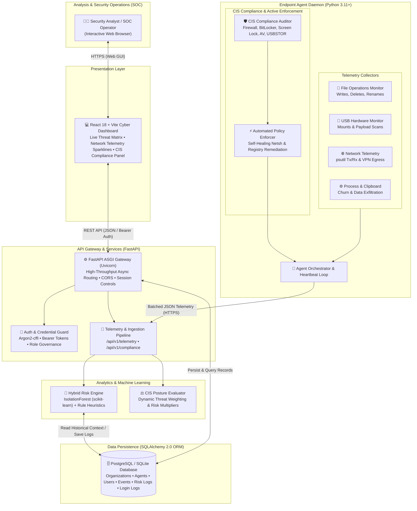
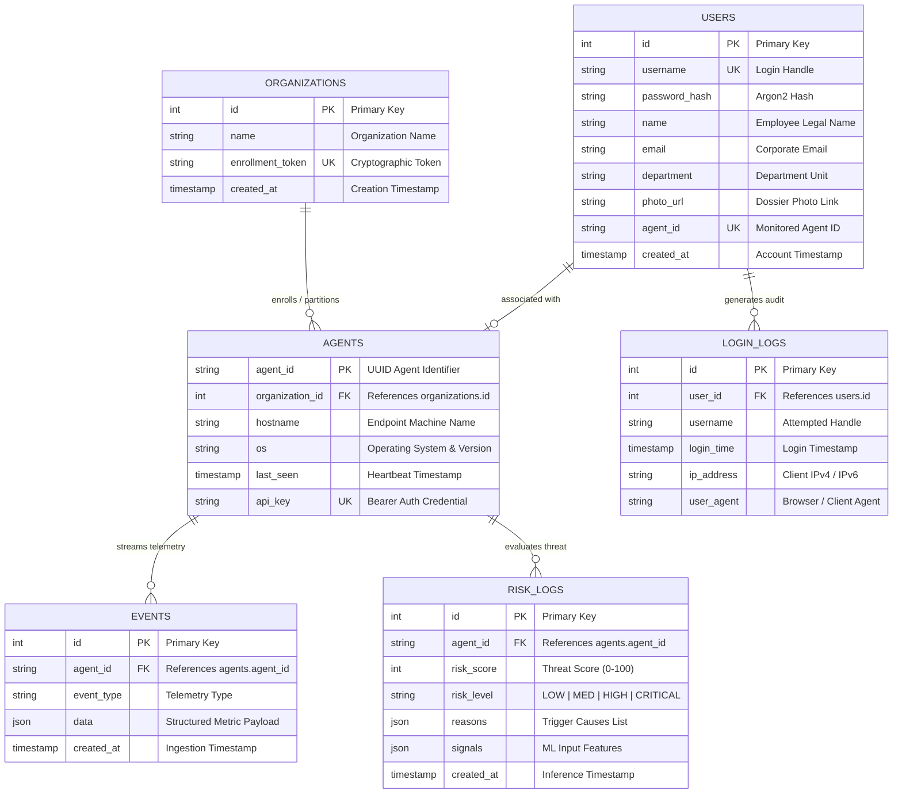

# 🛡️ Dikoryx — System Architecture & Technical Specification

> **Next-Gen Insider Threat Detection, Behavioral Telemetry & Automated CIS Compliance Platform**  
> *Official Architectural Blueprint, Threat Modeling, Data Dictionaries, and Entity-Relationship (ER) Specifications.*

---

## 📌 Executive Architecture & ER Visuals

Direct high-resolution graphical assets available in this repository:
- **System Architecture Diagram:** [`docs/architecture.png`](architecture.png)
- **Entity-Relationship (ER) Schema:** [`docs/er_diagram.png`](er_diagram.png)
- **Live SOC Dashboard View:** [`docs/screenshots/dashboard.png`](screenshots/dashboard.png)

---

## 1. 🏗️ High-Level System Architecture

---

## 2. 🔄 End-to-End Architectural Data Flow

1. **Endpoint Telemetry Capture & CIS Baseline Audit:**
   - The Python agent daemon initiates background collectors capturing file system activity, USB drive insertions, process creations, and network bandwidth (Tx/Rx bytes via `psutil`).
   - Concurrently, the **CIS Compliance Auditor** validates host security states (Windows Firewall profiles, BitLocker volume encryption, screen saver inactivity timeouts, Windows Defender Antivirus, and USB mass storage policies).

2. **Automated User Enforcement & Self-Healing:**
   - When policy drift is detected (e.g., local firewall turned OFF, screen lock inactive, or unauthorized USB storage attached), the **Automated Policy Enforcer** triggers native operating system remediation via `netsh`, registry commands (`reg.exe`), and `manage-bde`.
   - The agent documents the state before and after enforcement, tagging the action inside a `COMPLIANCE_STATUS` event.

3. **High-Throughput Ingestion & Authentication:**
   - Telemetry batches are sent over HTTPS to `POST /api/v1/telemetry` and `POST /api/v1/compliance`.
   - Requests are verified against Bearer API keys and organization enrollment tokens.

4. **Hybrid Risk Evaluation:**
   - Raw metrics are processed by the **Hybrid Risk Engine**:
     - **Unsupervised Anomaly Scoring (`IsolationForest`):** Evaluates write rates, delete frequencies, and network spikes against historical enterprise baselines.
     - **Deterministic Heuristics:** Flags acute threats such as USB exfiltration bursts, ransomware directory wiping, and commercial VPN egress.
     - **Compliance Risk Multiplier:** Fails or missing CIS controls inject risk penalties, escalating overall endpoint posture from `LOW` to `HIGH` or `CRITICAL`.

5. **Persistence & SOC Dashboarding:**
   - Evaluated threat logs, metrics, and compliance states are saved to the relational database using SQLAlchemy 2.0 ORM.
   - The React 18 + Vite cyber dashboard polls the API every 5 seconds, updating threat gauges, sparklines, and active CIS compliance control badges.

---

## 3. 🗄️ Relational Entity-Relationship (ER) Diagram

---

## 4. 📋 Comprehensive Data Dictionary

### 🏢 `organizations`
Multi-tenant root entity partitioning agents and access policies.

| Column | Data Type | Constraints | Description |
| :--- | :--- | :--- | :--- |
| `id` | `INTEGER` | `PRIMARY KEY`, Auto-increment | Unique identifier for organization. |
| `name` | `TEXT` | `NOT NULL` | Human-readable company or tenant name. |
| `enrollment_token` | `TEXT` | `UNIQUE`, `INDEX`, `NOT NULL` | High-entropy secret token for agent onboarding. |
| `created_at` | `TIMESTAMP` | Default `utcnow` | Organization creation timestamp. |

---

### 🖥️ `agents`
Registered endpoint daemons actively reporting telemetry.

| Column | Data Type | Constraints | Description |
| :--- | :--- | :--- | :--- |
| `agent_id` | `TEXT` | `PRIMARY KEY` | Globally unique agent identifier (`agent-<hex>`). |
| `organization_id` | `INTEGER` | `FOREIGN KEY` (`organizations.id`), `INDEX`, `NOT NULL` | Multi-tenant organization association. |
| `hostname` | `TEXT` | `NULLABLE` | Local network computer name. |
| `os` | `TEXT` | `NULLABLE` | Operating system platform and kernel build. |
| `last_seen` | `TIMESTAMP` | `NULLABLE` | Timestamp of most recent agent transmission. |
| `api_key` | `TEXT` | `UNIQUE`, `INDEX`, `NOT NULL` | Per-agent Bearer token for authenticating telemetry. |

---

### 👤 `users`
Security personnel, analysts, and monitored employee accounts.

| Column | Data Type | Constraints | Description |
| :--- | :--- | :--- | :--- |
| `id` | `INTEGER` | `PRIMARY KEY`, Auto-increment | Internal surrogate user ID. |
| `username` | `TEXT` | `UNIQUE`, `INDEX`, `NOT NULL` | Account login username. |
| `password_hash` | `TEXT` | `NOT NULL` | Cryptographically salted Argon2 hash. |
| `name` | `TEXT` | `NULLABLE` | Full employee name for personnel dossier. |
| `email` | `TEXT` | `NULLABLE` | Corporate contact email. |
| `department` | `TEXT` | `NULLABLE` | Functional unit (e.g. Engineering, Finance). |
| `photo_url` | `TEXT` | `NULLABLE` | URL for UI employee profile rendering. |
| `agent_id` | `TEXT` | `UNIQUE`, `NULLABLE` | Direct link to the employee's assigned workstation agent. |
| `created_at` | `TIMESTAMP` | Default `utcnow` | Timestamp of account registration. |

---

### 🔐 `login_logs`
Audit trail of user and analyst authentication attempts.

| Column | Data Type | Constraints | Description |
| :--- | :--- | :--- | :--- |
| `id` | `INTEGER` | `PRIMARY KEY`, Auto-increment | Log identifier. |
| `user_id` | `INTEGER` | `NULLABLE` | Reference to `users.id` if authentication succeeded. |
| `username` | `TEXT` | `NOT NULL` | Username submitted during login attempt. |
| `login_time` | `TIMESTAMP` | Default `utcnow` | Timestamp of authentication attempt. |
| `ip_address` | `TEXT` | `NULLABLE` | Originating IP address of user client. |
| `user_agent` | `TEXT` | `NULLABLE` | Web browser or HTTP client user-agent string. |

---

### ⚡ `events`
High-volume time-series telemetry store capturing system events.

| Column | Data Type | Constraints | Description |
| :--- | :--- | :--- | :--- |
| `id` | `INTEGER` | `PRIMARY KEY`, Auto-increment | Telemetry event entry ID. |
| `agent_id` | `TEXT` | `INDEX`, `NOT NULL` | Originating agent ID. |
| `event_type` | `TEXT` | `INDEX`, `NOT NULL` | Event classifier (`FILE_ACTIVITY_SUMMARY`, `NETWORK_ACTIVITY_SUMMARY`, `COMPLIANCE_STATUS`, etc.). |
| `data` | `JSON` | `NOT NULL` | Structured telemetry payload (bytes, counters, control states). |
| `created_at` | `TIMESTAMP` | Default `utcnow` | Ingestion timestamp on server. |

---

### 🚨 `risk_logs`
Analytical risk assessment records generated by the Hybrid Risk Engine.

| Column | Data Type | Constraints | Description |
| :--- | :--- | :--- | :--- |
| `id` | `INTEGER` | `PRIMARY KEY`, Auto-increment | Risk assessment record ID. |
| `agent_id` | `TEXT` | `INDEX`, `NOT NULL` | Evaluated endpoint agent ID. |
| `risk_score` | `INTEGER` | `NOT NULL` | Computed threat level integer (0 to 100). |
| `risk_level` | `TEXT` | `NOT NULL` | Threat severity tier: `LOW`, `MEDIUM`, `HIGH`, `CRITICAL`. |
| `reasons` | `JSON` | `NOT NULL` | Array of descriptive causes triggering score elevation. |
| `signals` | `JSON` | `NOT NULL` | Raw numeric feature vector consumed by ML model. |
| `created_at` | `TIMESTAMP` | Default `utcnow` | Evaluation timestamp. |

---

## 5. 🛡️ Security, Hardening & Compliance Framework

### 🔒 Cryptographic Standards
- **Password Hashes:** Argon2 (`argon2-cffi`), resistant to GPU/ASIC brute-force attacks.
- **Agent Identity:** High-entropy random tokens via Python `secrets.token_urlsafe(32)`.
- **Database Transport:** TLS 1.3 encrypted connections (`sslmode=require&channel_binding=require`).

### 🛡️ CIS Controls v8 Mapping & Auto-Remediation Matrix
| CIS Control | Audit Command / Registry Key | Auto-Enforcement Command |
| :--- | :--- | :--- |
| **Firewall** | `netsh advfirewall show allprofiles` | `netsh advfirewall set allprofiles state on` |
| **Screen Lock** | `HKCU\Control Panel\Desktop\ScreenSaveTimeOut` | `reg add "HKCU\Control Panel\Desktop" /v ScreenSaveActive /t REG_SZ /d 1 /f` `reg add "HKCU\Control Panel\Desktop" /v ScreenSaverIsSecure /t REG_SZ /d 1 /f` `reg add "HKCU\Control Panel\Desktop" /v ScreenSaveTimeOut /t REG_SZ /d 300 /f` |
| **Antivirus** | `powershell Get-MpComputerStatus` (`AMServiceEnabled`) | Alerts SOC if disabled; verifies Windows Defender real-time engine |
| **Disk Encryption** | `manage-bde -status` | Audits BitLocker volume status across physical drives |
| **USB Storage** | `HKLM\SYSTEM\CurrentControlSet\Services\USBSTOR` | `reg add "HKLM\SYSTEM\CurrentControlSet\Services\USBSTOR" /v Start /t REG_DWORD /d 4 /f` |

---

*Dikoryx Architecture & Engineering Specification • Production Ready*

